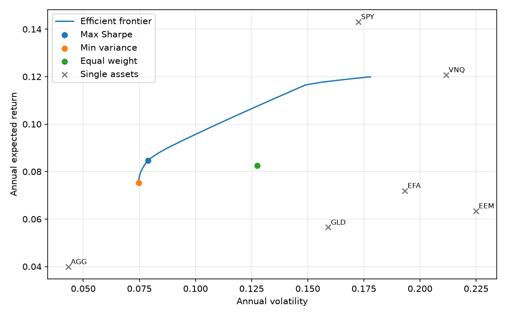

# Portfolio Optimizer

Mean-variance portfolio optimisation (Markowitz, 1952) for a set of ETFs or stocks: the minimum-variance portfolio, the maximum-Sharpe portfolio and the efficient frontier, with long-only weights and an optional cap per asset.

It also answers the question that usually gets skipped: **do the optimised weights still look good on data they were not estimated on?** With `--holdout-start`, weights are estimated on the earlier period and then held fixed through the later one, next to an equal-weight portfolio.   

## What it does

| Piece | Detail |
|---|---|
| Inputs | Daily prices from yfinance, or a CSV with a `Date` column and one column per asset |
| Estimates | Annualised mean returns; covariance with Ledoit-Wolf shrinkage (or the sample covariance with `--no-shrink`) |
| Portfolios | Minimum variance, maximum Sharpe, any target return; equal weight as the benchmark |
| Constraints | Weights sum to one, no short positions, optional cap per asset (`--max-weight`) |
| Solver | SciPy SLSQP |
| Output | Weights, in-sample statistics, optional out-of-sample statistics, efficient-frontier chart |

## Quick start

```bash
pip install -r requirements.txt
python main.py                                         # SPY EFA EEM AGG GLD VNQ since 2010
python main.py --max-weight 0.4 --chart outputs/frontier.png
python main.py --holdout-start 2021-01-01              # estimate before 2021, test after
```

## Why shrinkage and a weight cap

Mean-variance weights are very sensitive to estimation error: small changes in expected returns swing the maximum-Sharpe portfolio into one or two assets. Shrinking the covariance and capping weights make the result steadier. Expected returns stay the weakest input, which is why the minimum-variance portfolio, which ignores them, often holds up better out of sample. The holdout option lets you check this on real data.

## Results

Six ETFs (SPY, EFA, EEM, AGG, GLD, VNQ), a 40% cap per asset and Ledoit-Wolf shrinkage. Weights are estimated on January 2010 to December 2020 and then held fixed from January 2021 to November 2026. The risk-free rate is set at 2%.

| Weights | Max Sharpe | Min variance | Equal weight |
|---|---|---|---|
| AGG (US bonds) | 40.0% | 40.0% | 16.7% |
| SPY (US equities) | 40.0% | 29.4% | 16.7% |
| GLD (gold) | 19.8% | 30.6% | 16.7% |
| VNQ (real estate) | 0.2% | 0% | 16.7% |
| EFA, EEM (other equities) | 0% | 0% | 33.3% |

| Sharpe ratio | Max Sharpe | Min variance | Equal weight |
|---|---|---|---|
| Estimated, 2010-2020 | 0.82 | 0.74 | 0.49 |
| Realised, 2021-2026 | 0.59 | 0.56 | 0.44 |
| Realised return, 2021-2026 | 7.5% | 7.2% | 7.3% |
| Realised volatility, 2021-2026 | 9.3% | 9.3% | 12.0% |

Both optimised portfolios beat equal weight out of sample, but only by taking less risk: their returns were about the same. For the two optimised portfolios, the estimated Sharpe ratios overstated what happened by about 0.2, which is estimation error showing up in practice. The 40% cap binds on bonds in both portfolios and on US equities in the max-Sharpe one, so it is doing real work. This is one five-year test period, and it includes 2022, when bonds and equities fell together.



## Tests

```bash
pytest -q
```

The tests check the minimum-variance weights against the closed-form two-asset solution, that weights are long-only, sum to one and respect the cap, that the maximum-Sharpe portfolio beats every point on the frontier, and that the frontier's risk rises with its return.

An interactive three-asset version runs in the browser at [cesarglez.com](https://cesarglez.com/#optimizer).

## Project structure

```
├── main.py
├── src/
│   ├── data.py        # prices (yfinance or CSV), annualised mean and shrunk covariance
│   └── optimize.py    # min variance, max Sharpe, target return, frontier
└── tests/test_optimize.py
```

## Disclaimer

For research and education only. Not investment advice.

## License

MIT
